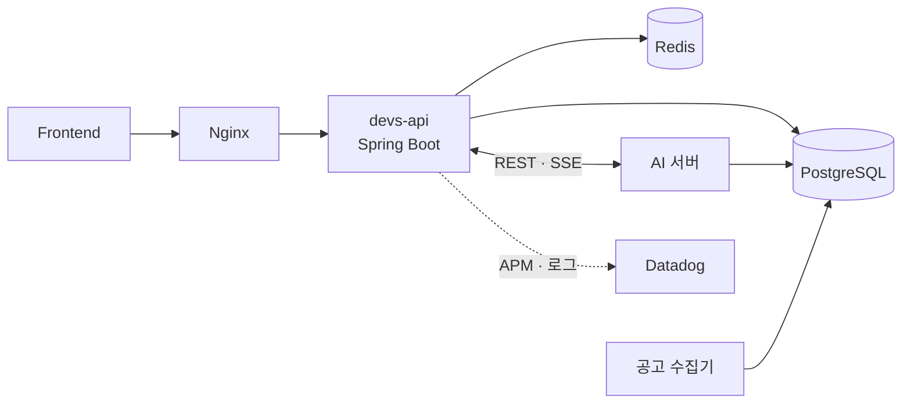
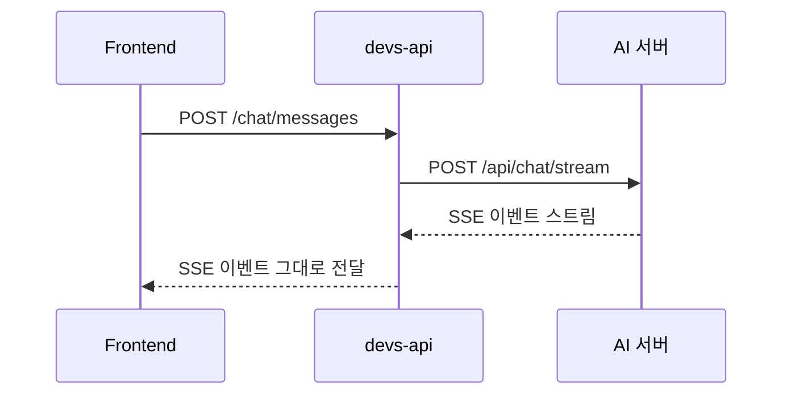
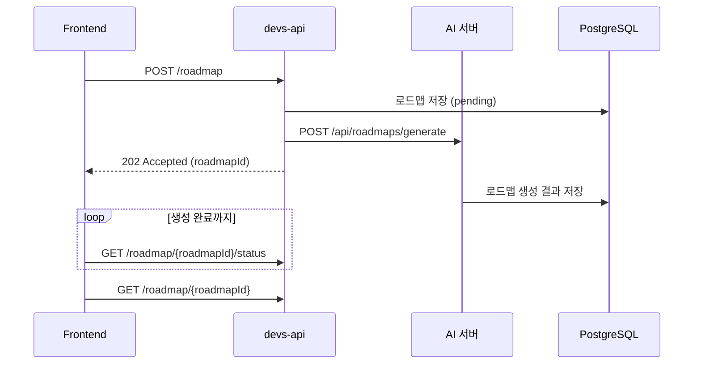

# Devs-BE

개발자 채용 공고를 근거로 취업 준비생의 공부 방향을 잡아주는 플랫폼 **Devs**의 백엔드 서버입니다.

## 소개

Devs는 개발자 채용 공고를 주기적으로 수집해 기술 스택 수요를 분석하고, 그 결과를 실제 학습으로 이어지게 합니다.

대시보드에서는 지금 시장에서 많이 요구하는 기술 스택과 기업 규모별로 선호하는 기술을 한눈에 볼 수 있습니다. 관심 있는 기업들을 골라 요구 기술을 비교하면, 내가 가진 기술과 얼마나 맞는지 매칭률도 확인할 수 있습니다. 매주 기술 트렌드의 증감을 AI가 요약한 주간 리포트가 메일로 발송되어, 시장의 흐름을 꾸준히 따라갈 수 있습니다.

무엇을 공부할지 정했다면 AI 학습 로드맵으로 실행에 옮길 수 있습니다. 희망 직군과 기간을 고르면 주차·일 단위의 학습 계획이 만들어지고, 하루 학습을 마칠 때마다 회고를 남깁니다. 남긴 회고는 익명 회고 게시판에서 다른 사용자들과 공유할 수 있습니다.

공부하다 궁금한 점은 AI 챗봇에게 바로 물어볼 수 있습니다. 챗봇은 답변을 생성되는 대로 실시간 스트리밍으로 보여주고, 대화는 세션 단위로 저장되어 언제든 다시 확인할 수 있습니다.

## 주요 기능

| 기능 | 설명 |
| --- | --- |
| 대시보드 | 오늘 수집 공고 수, 채용 중인 기업 수, 가장 많이 언급된 기술, 가장 많이 오른 기술, 직군별·기업 규모별 인기 기술 스택 |
| 기업 비교 | 기업 검색, 여러 기업의 공고 수·상위 기술·공통 요구 기술 비교, 내 보유 기술과의 매칭률 |
| 주간 리포트 | 기술 트렌드 증감과 AI 요약을 매주 월요일 메일로 발송, 전체·직군별 리포트 구독 설정 |
| AI 학습 로드맵 | 직군·보유 기술·목표 기간(1~12주)을 고르면 주차·일 단위 로드맵 생성, 여러 개 생성 가능(최대 10개, 하루 3개) |
| AI 챗봇 | 실시간 스트리밍(SSE) 답변, 세션 단위 대화 저장·조회·삭제 |
| 회고 | 하루 학습 완료 시 회고 작성, 익명 회고 게시판과 좋아요 |
| 회원 | 이메일 인증 회원가입, Google·GitHub 소셜 로그인, JWT 인증, 관심 직군·기술 스택 설정 |

## 기술 스택

| 분류 | 기술 |
| --- | --- |
| Language | Java 21 |
| Framework | Spring Boot 4.1, Spring MVC, Spring Security |
| 인증 | JWT(Access·Refresh 토큰), OAuth2(Google, GitHub), 이메일 인증 |
| Data Access | Spring Data JPA, QueryDSL, JdbcClient |
| Database | PostgreSQL 16 (pgvector), Redis 7 |
| AI 연동 | WebClient (REST, SSE 스트리밍) |
| Infra | Docker Compose, Nginx, GitHub Actions (self-hosted runner) |
| Monitoring | Datadog APM, 로그 수집 |
| API 문서 | springdoc-openapi (Swagger UI) |

## 시스템 구성



- 채용 공고는 별도 수집기가 PostgreSQL에 적재하고, 백엔드는 이를 집계해 대시보드·기업 비교·리포트로 제공합니다.
- AI 서버는 외부에 노출되지 않고 백엔드를 통해서만 호출되며, 같은 PostgreSQL을 공유합니다.
- Redis는 대시보드 캐시, Refresh 토큰, 이메일 인증 코드, 로드맵 일일 생성 횟수를 저장합니다.

## AI 서버 연동

### AI 챗봇: SSE 중계



- 백엔드는 세션 소유자를 확인한 뒤 AI 서버의 SSE 스트림을 프론트로 그대로 중계합니다.
- 스트림이 시작된 뒤에는 HTTP 상태 코드를 바꿀 수 없으므로, AI 서버 오류는 `event: error` 이벤트로 전달합니다.

### AI 학습 로드맵: 비동기 생성 + 상태 폴링



- 로드맵 생성은 시간이 오래 걸리므로 요청을 접수만 하고 바로 `202`를 응답합니다.
- 생성이 진행 중인 로드맵은 사용자당 하나로 제한하고, 생성 개수(최대 10개)와 하루 생성 횟수(3회)를 검사합니다.

### 주간 리포트: 스케줄러 + 콜백

| 시각 (KST) | 동작 |
| --- | --- |
| 매주 월요일 00:10 | 지난주 리포트를 생성하고 AI 서버에 요약 생성을 요청 (`POST /api/reports/generate`) |
| 요약 완료 시 | AI 서버가 `POST /internal/reports/ready`로 완료를 알림 |
| 매주 월요일 09:00 | 구독자에게 지난주 리포트 메일 발송 |

## 성능 개선: 대시보드 요약 캐싱

`GET /dashboard/summary`는 요청마다 집계 쿼리 6개를 실행해 응답 시간이 p95 기준 300ms대였습니다(Datadog). 요약 값은 모든 사용자에게 같고 몇 분 단위로 늦어도 괜찮기 때문에 Redis 캐시를 도입했습니다.

- **캐시 워밍**: 스케줄러가 서버 시작 직후와 이후 10분마다 요약을 미리 계산해 Redis에 저장합니다. 사용자 요청은 대부분 캐시에서 바로 응답합니다.
- **TTL 30분**: 스케줄러가 멈춰도 오래된 값이 무기한 남지 않도록 안전장치로 둡니다.
- **장애 대응**: Redis 장애나 캐시 값 손상 시 DB에서 직접 조회합니다. Redis 연결·명령 타임아웃을 1초로 제한해 Redis 장애가 응답 지연으로 번지지 않게 했습니다.

## API

전체 명세는 서버 실행 후 Swagger UI(`/swagger-ui/index.html`)에서 확인할 수 있습니다.

<details>
<summary>API 목록</summary>

| 도메인 | Method | Path | 설명 |
| --- | --- | --- | --- |
| 회원 | POST | `/user/email/send` | 이메일 인증 코드 발송 |
| | POST | `/user/email/verify` | 이메일 인증 코드 확인 |
| | POST | `/user/signup` | 회원가입 |
| | POST | `/user/login` | 로그인 |
| | POST | `/user/reissue` | 토큰 재발급 |
| | POST | `/user/oauth/google/token` | Google 로그인 토큰 발급 |
| | POST | `/user/oauth/github/token` | GitHub 로그인 토큰 발급 |
| | POST | `/user/logout` | 로그아웃 |
| | GET | `/user/my` | 마이페이지 조회 |
| | PUT | `/user/major` | 관심 직군 설정 |
| | PUT | `/user/tech-stack` | 보유 기술 스택 설정 |
| | GET | `/user/report-subscription` | 리포트 구독 조회 |
| | PUT | `/user/report-subscription` | 리포트 구독 수정 |
| 직군 | GET | `/majors` | 직군 목록 조회 |
| 대시보드 | GET | `/dashboard/summary` | 대시보드 요약 |
| | GET | `/dashboard/popular-tech-stacks` | 인기 기술 스택 |
| | GET | `/dashboard/company-size-tech-stacks` | 기업 규모별 기술 스택 |
| | GET | `/dashboard/best-tech-stacks` | 최근 1주·1개월 상승 기술 스택 |
| 기업 | GET | `/company` | 기업 검색 |
| | GET | `/company/compare/posting-counts` | 기업별 공고 수 비교 |
| | GET | `/company/compare/top-skills` | 기업별 상위 기술 비교 |
| | GET | `/company/compare/match-rates` | 내 기술과의 매칭률 |
| | GET | `/company/compare/common-skills` | 공통 요구 기술 |
| | GET | `/company/compare/skill-mentions` | 기술 언급량 그래프 |
| 리포트 | GET | `/report/llm` | AI 요약 리포트 |
| | GET | `/report/popular-tech-stack` | 인기 기술 스택 |
| | GET | `/report/max-increase` | 가장 많이 증가한 기술 |
| | GET | `/report/max-decrease` | 가장 많이 감소한 기술 |
| | GET | `/report/tech-mentions` | 기술 언급량 |
| | GET | `/report/weekly-collected-count` | 주간 수집 공고 수 |
| | GET | `/report/week-range` | 리포트 기준 주간 범위 |
| | POST | `/report/weekly` | 주간 리포트 수동 생성 (관리자) |
| | POST | `/report/weekly/mail` | 주간 리포트 메일 단건 발송 (관리자) |
| | POST | `/report/weekly/mail/all` | 주간 리포트 메일 전체 발송 (관리자) |
| | POST | `/internal/reports/ready` | AI 리포트 생성 완료 통지 (AI 서버) |
| 로드맵 | POST | `/roadmap` | 로드맵 생성 요청 |
| | GET | `/roadmap` | 내 로드맵 목록 |
| | GET | `/roadmap/{roadmapId}` | 로드맵 상세 |
| | DELETE | `/roadmap/{roadmapId}` | 로드맵 삭제 |
| | GET | `/roadmap/{roadmapId}/status` | 로드맵 생성 상태 |
| | PATCH | `/roadmap/items/{itemId}` | 학습 항목 체크 |
| | POST | `/roadmap/{roadmapId}/days/{dayNo}/complete` | 하루 학습 완료 및 회고 작성 |
| AI 챗봇 | POST | `/chat/messages` | 메시지 전송 (SSE) |
| | GET | `/chat/sessions` | 대화 세션 목록 |
| | GET | `/chat/sessions/{sessionId}/messages` | 대화 내역 |
| | DELETE | `/chat/sessions/{sessionId}` | 대화 세션 삭제 |
| 회고 | GET | `/retrospect` | 익명 회고 게시판 |
| | GET | `/retrospect/my` | 내 회고 목록 |
| | POST | `/like/{retrospectId}` | 회고 좋아요 |
| | DELETE | `/like/{retrospectId}` | 회고 좋아요 취소 |

</details>

## 프로젝트 구조

```
src/main/java/com/example/devs
├── domain
│   ├── chat              AI 챗봇
│   ├── company           기업 검색·비교
│   ├── crawl_run         공고 수집 실행 이력
│   ├── dashboard         대시보드
│   ├── job_posting       채용 공고
│   ├── report            주간 리포트
│   ├── retrospect        회고
│   ├── retrospect_like   회고 좋아요
│   ├── roadmap           AI 학습 로드맵
│   ├── skill             기술 스택
│   ├── tech_field        직군
│   ├── user              회원·인증
│   ├── user_major        관심 직군
│   └── user_skill        보유 기술
└── global
    ├── config            설정
    ├── error             공통 예외 처리
    └── security          JWT·OAuth2 인증
```

각 도메인은 `domain`(엔티티·리포지토리), `presentation`(컨트롤러·DTO), `service`, `exception` 패키지로 나뉩니다.

## 실행 방법

### 환경 변수

| 이름 | 설명 |
| --- | --- |
| `DB_URL`, `DB_USERNAME`, `DB_PASSWORD` | PostgreSQL 접속 정보 |
| `REDIS_HOST`, `REDIS_PORT` | Redis 접속 정보 |
| `JWT_SECRET` | JWT 서명 키 |
| `MAIL_USERNAME`, `MAIL_PASSWORD` | 메일 발송용 Gmail 계정 |
| `GOOGLE_CLIENT_ID`, `GOOGLE_CLIENT_SECRET` | Google OAuth |
| `GITHUB_CLIENT_ID`, `GITHUB_CLIENT_SECRET` | GitHub OAuth |
| `AI_BASE_URL` | AI 서버 주소 (기본값 `http://localhost:8000`) |
| `CORS_ALLOWED_ORIGINS` | 허용할 프론트 주소 (기본값 `http://localhost:5173`) |
| `OAUTH_FRONTEND_REDIRECT_URI` | 소셜 로그인 후 이동할 프론트 주소 |
| `ADMIN_KEY` | 관리자 API 호출 키 |

### 로컬 실행

PostgreSQL과 Redis를 띄우고 위 환경 변수를 설정한 뒤 실행합니다.

```bash
./gradlew bootRun
```

### Docker Compose

`.env.example`을 참고해 `.env`를 만든 뒤 실행합니다. 앱, PostgreSQL, Redis가 함께 뜹니다.

```bash
docker compose -f compose.stag.yml up -d --build
```

## 배포

| 브랜치 | 동작 |
| --- | --- |
| PR → `develop`, `main` | CI에서 빌드 검증 |
| `develop` push | 스테이징 서버 배포 |
| `main` push | 운영 서버 배포 |

배포는 서버에 설치한 GitHub Actions self-hosted runner가 최신 코드를 받아 `docker compose`로 앱 컨테이너를 다시 빌드·실행하는 방식입니다. 운영 환경에서는 Datadog 에이전트가 함께 실행되어 APM 트레이스와 로그를 수집합니다.

## 협업 규칙

- 브랜치: `{이슈번호}-{타입}-{작업명}` (예: `76-refactor-dashboard-Improve-performance`)에서 작업 후 `develop`으로 PR, 배포 시 `develop` → `main`으로 PR
- 커밋 메시지: `feat : `, `fix : `, `refactor : `, `chore : `, `docs : ` 접두사 사용
